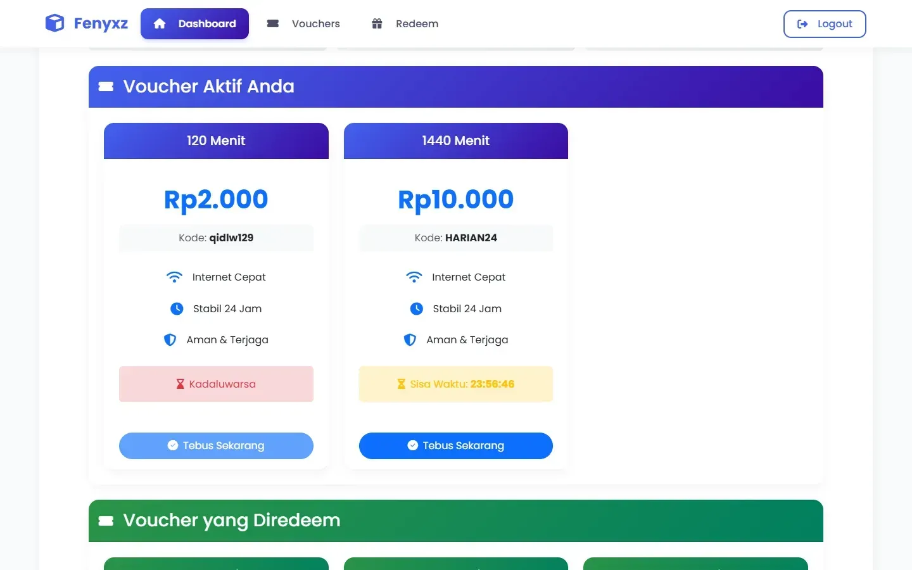
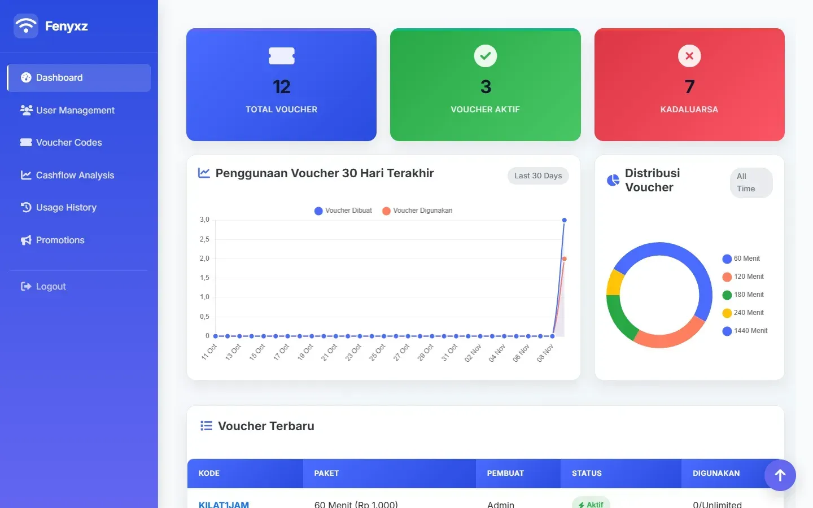
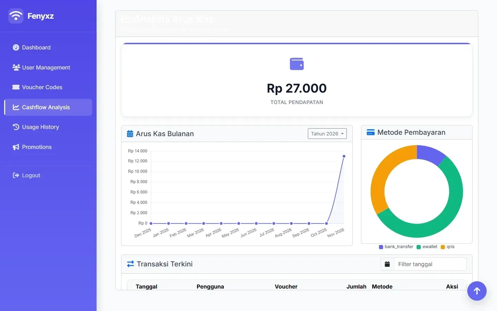
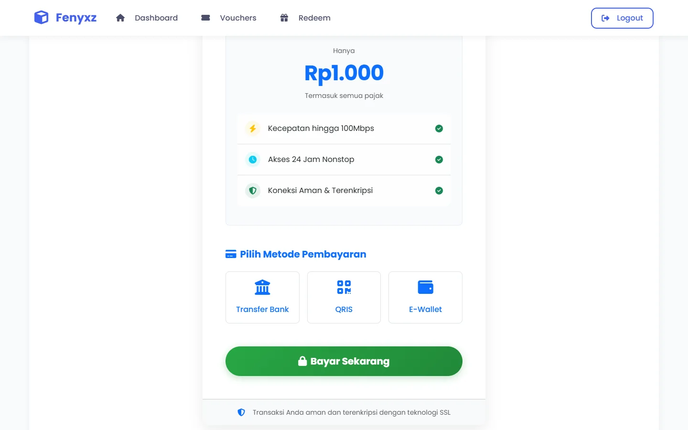
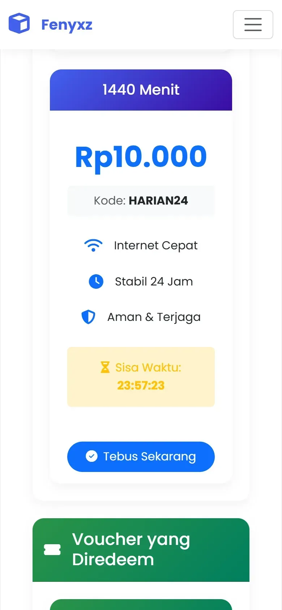

# Fenyxz WiFi — Platform Voucher Hotspot

Aplikasi web untuk menjual dan mengelola voucher WiFi. Pelanggan membeli paket internet,
menebus kode voucher, lalu memantau sisa waktunya. Admin mengelola kode voucher, promo,
riwayat pemakaian, dan arus kas dari satu panel.



## Fitur

**Pelanggan**

- Daftar dan masuk sebagai pelanggan.
- Katalog paket (durasi dan harga), hanya menampilkan voucher yang belum terjual.
- Pembelian dengan pilihan metode bayar: transfer bank, QRIS, atau e-wallet.
- Invoice per transaksi yang bisa dicetak, lengkap dengan instruksi pemakaian.
- Tebus (redeem) kode voucher: sistem mengecek kode ada, belum dipakai, milik pembeli, dan belum kedaluwarsa.
- Dashboard dengan hitung mundur sisa waktu tiap voucher dan total sisa waktu.
- Riwayat pembelian dan pemakaian.

**Admin**

- Dashboard: total voucher, voucher aktif dan kedaluwarsa, grafik pemakaian 30 hari, distribusi paket.
- CRUD kode voucher (kode, durasi, harga, promo, tanggal kedaluwarsa) dengan pencarian.
- Promo (potongan harga atau bonus menit) dengan periode dan minimal pembelian.
- Riwayat pemakaian voucher.
- Analisis arus kas: total pendapatan, grafik 12 bulan, dan porsi tiap metode bayar.
- Manajemen pengguna (khusus role admin).

> Pembayaran masih disimulasikan: metode bayar dicatat, tetapi belum tersambung ke payment gateway.

| Panel admin                                     | Arus kas                                           |
| ----------------------------------------------- | -------------------------------------------------- |
|  |  |

| Pembelian                                              | Versi HP                                         |
| ------------------------------------------------------ | ------------------------------------------------ |
|  |  |

## Teknologi

Laravel 12 (PHP 8.2), MySQL/MariaDB, Blade + Bootstrap 5, Chart.js, Font Awesome, Vite + Tailwind CSS 4.

## Menjalankan secara lokal

Butuh PHP 8.2+, Composer, Node.js, dan MySQL/MariaDB (mis. XAMPP).

```bash
composer install
npm install
cp .env.example .env
php artisan key:generate
```

Atur koneksi database di `.env` (`DB_CONNECTION=mysql`, `DB_DATABASE=voucher_wifi`, dst.),
buat database-nya, lalu:

```bash
php artisan migrate --seed
npm run build
php artisan serve
```

Seeder membuat tiga paket contoh dan dua akun awal: `admin@gmail.com` (admin) dan
`user@gmail.com` (pelanggan). Password-nya diambil dari `SEED_ADMIN_PASSWORD` dan
`SEED_USER_PASSWORD` di `.env` (bawaan: `password`). Ganti setelah login pertama.

- Login admin: `http://127.0.0.1:8000/`
- Login pelanggan: `http://127.0.0.1:8000/user/login`

## Struktur singkat

| Bagian                                   | Isi                                                     |
| ---------------------------------------- | ------------------------------------------------------- |
| `app/Http/Controllers/Admin`             | Voucher, promo, riwayat pemakaian, arus kas             |
| `app/Http/Controllers/User`              | Dashboard, katalog, pembelian, redeem, invoice, riwayat |
| `app/Http/Middleware/UserAkses.php`      | Pembatasan halaman berdasarkan role                     |
| `app/Models`                             | `VoucherCode`, `Promotion`, `CashflowAnalysis`, `UsageHistory`, `User` |
| `resources/views/admin`, `resources/views/user` | Tampilan panel admin dan pelanggan               |

Dibuat oleh [Fadal Hakim Azizi](https://fadalhakim.ai.id).
